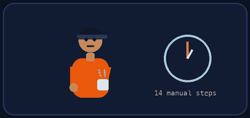
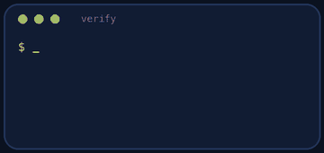

<p align="center"></p>

| | |
|-|-|
| **Time** | 75-90 min |
| **Cost** | free |
| **You need** | Bash and Python 3 in your Ubuntu environment |

## How this lab works

1. **Fork** this repository to your own GitHub account (button at the top right).
2. Clone **your fork** in your Ubuntu environment (WSL on Windows, your OrbStack machine on Mac).
3. Read the lab below (the same text is in [`LAB.md`](LAB.md)) and follow the mission.
4. Answer the questions in [`SUBMISSION.md`](SUBMISSION.md). Where a question asks for output, paste it in a code block. No screenshots needed.
5. Commit and push. Open the **Actions** tab of your fork (click *I understand my workflows, go ahead and enable them* the first time). The **Lab check** shows what is still missing.
6. When the check is green, **submit the URL of your fork** in the course platform.

> [!NOTE]
> The check only looks at your answers and any files the lab asks you to commit. Your instructor reads your work and may ask you to explain any line.

<p align="center"></p>

## 🎬 The situation

<p align="center"></p>

The wiki page is still open on the on-call engineer's screen, with their notes in the margin:

```text
Deploy Clippy                                                (wiki, 14 steps)
 1. ssh to the server
 ...
 8. copy the new files over the old ones           <- overwrote the only working copy
 9. restart the app                                <- SKIPPED, the site served the old version all weekend
 ...
14. tell the team it is live                       <- nobody could tell what was running
```

Last Friday, 17:40, step 9 was skipped. Your lead gives the whole requirement in three lines: *"One command, no thinking. It must never break the live site. It must notice a bad release and put things back by itself."* The wiki page is the runbook for people; you are writing the runbook for a machine.

> [!IMPORTANT]
> **Your mission**
> - Write `deploy.sh`: one command that deploys a version
> - Make the switch **atomic**, so nobody ever sees a half-copied release
> - Check health after the switch and **roll back automatically** if the new version is sick
> - Keep the last three releases, log everything, and be safe to run twice

**Time:** 75-90 min | **Cost:** free | **You need:** Bash, Python 3 and `curl` in your Ubuntu environment

<p align="center"></p>

## Part 0 - Set the scene

Fork this repository, clone your fork, and run:

```bash
./setup.sh
```

It prepares `~/deploy-lab` with:

- `incoming/` : six built releases `v1.0.0` ... `v1.5.0`. **One of them is broken.**
- `releases/` : where deployed releases will live (empty)
- `app-ctl.sh` : starts, stops and restarts the app that runs from the symlink `~/deploy-lab/current`

Your script goes in this repository as `deploy.sh`.

<p align="center"></p>

## Part 1 - Recon: understand the pieces by hand

<p align="center"></p>

Do one deploy completely by hand before you automate it:

```bash
cd ~/deploy-lab
cp -r incoming/v1.0.0 releases/v1.0.0
ln -s ~/deploy-lab/releases/v1.0.0 current
./app-ctl.sh restart
curl http://127.0.0.1:8090/healthz
```

1. What does `/healthz` return? Where does the `version` come from?
2. Now repeat with `v1.2.0` instead: `cp -r incoming/v1.2.0 releases/`, point `current` at it, restart, and call `/healthz` again. What do you get? (`curl -i` shows the status code.) What did you just do to your "production"?
3. Point `current` back at `v1.0.0`. How many commands did you need to recover, and how fast could you do it at 17:40 on a Friday?

> [!NOTE]
> **Predict** If a deploy takes five seconds to copy files and someone requests the site in the middle, what do they see when you copy straight into the live directory? What do they see if you build the new release **next to** it and then change one symlink?

<p align="center"></p>

## Part 2 - Build deploy.sh

The contract is simple. `./deploy.sh <version>`:

| Situation | Behaviour |
|-----------|-----------|
| No argument | Print a usage message, exit code **2** |
| Version not in `incoming/` | Print an error, exit code **2**, change **nothing** |
| New healthy version | Exit code **0**, `current` points at it, the app is running it |
| New version fails its health check | **Roll back** to the previous version, restart, exit code **1** |
| Same version as the current one | Do nothing harmful, exit code **0** |
| After a successful deploy | Keep only the **3 newest** releases, never delete `current` |

Design rules (this is where you think, not paste):

1. `set -euo pipefail` at the top. Know what each letter does.
2. Use `DEPLOY_HOME` (default `$HOME/deploy-lab`) so the script is not tied to one machine.
3. **Copy to a temporary name, then move** it into `releases/`. A rename is atomic, a long copy is not.
4. **Swap the symlink atomically:** create a new symlink under a temporary name and `mv -T` it over `current`. (`ln -sfn` directly is two steps under the hood.)
5. After the restart, poll `/healthz` for up to ten seconds. One failed `curl` is not a verdict, ten seconds of failures is.
6. Remember the previous version **before** you switch, so rollback knows where to go.
7. `trap ... EXIT` to remove temporary files, whether the script succeeds or fails.
8. Log every step to `$DEPLOY_HOME/deploy.log` **with a time**, and print the same lines to the terminal. Messages go to stderr so scripts can capture stdout.

Build it in layers and run it often. A suggested order: arguments and errors, copy, symlink, restart, health check, rollback, pruning, log.

> [!TIP]
> **Checkpoint** `./deploy.sh v1.0.0` then `./deploy.sh v1.1.0` leaves `current -> releases/v1.1.0`, `curl .../healthz` reports `1.1.0`, and `deploy.log` tells the whole story.

<p align="center"></p>

## Part 3 - Break it on purpose

1. **The bad release.** Run `./deploy.sh v1.2.0`. Watch the terminal. Your script should detect the failure, say so clearly, restore `v1.1.0`, and exit with 1. Check with `curl` that the site is still up and serving `1.1.0`.

> [!WARNING]
> **Break it** Temporarily comment out your rollback and run the broken deploy again. Count how many seconds the site was serving errors. That is the downtime your rollback code prevents. Put it back.

2. **The impatient engineer.** Hit `Ctrl-C` in the middle of a deploy (add a `sleep 5` after the copy to have time). What does your `trap` clean up? Is there a half-copied directory left in `releases/`?
3. **The typo.** `./deploy.sh v9.9.9` and `./deploy.sh` with no argument. Check the exit codes with `echo $?`.
4. **Deploy the same version twice.** What happens to the running app? Is that the behaviour you want?

> [!NOTE]
> **Think** What if two engineers run the script at the same moment? Which step could they both be in at once? How would a lock (for example `flock`) fix that?

<p align="center"></p>

## Part 4 - Prove it

<p align="center"></p>

```bash
./verify.sh
```

It runs your script against all six releases in a private temporary directory (your own `~/deploy-lab` is not touched), including the broken one.

<p align="center"></p>

## Level up (optional)

- **`--dry-run`.** Add a flag that prints what would happen without doing it.
- **A lock.** Use `flock` so a second concurrent deploy refuses with a clear message.
- **shellcheck.** Run `shellcheck deploy.sh` and fix everything it reports. Which warning taught you something?
- **Make it a function library.** Split `log`, `healthy` and `rollback` into functions. Which ones would you reuse in a Terraform wrapper?

<!-- teardown:start (generated by labs.py, do not edit) -->
## Tear down (mandatory)

<p align="center"></p>

Resources left behind cost money, keep doors open and pollute the next lab. Removing what you created is part of the job, so it is part of the submission: **you must prove it is gone**.

Do this **last**, after you have pasted your `verify` output into `SUBMISSION.md` (once you tear down, the lab can no longer be verified).

1. Run `./teardown.sh`. It stops the app and deletes `~/deploy-lab`.

Then run the proof:

```bash
./verify-teardown.sh
```

It prints a list of checks and must end with **TEARDOWN VERIFIED**. If it reports leftovers, remove them and run it again. Paste the full output in your submission.
<!-- teardown:end -->

<!-- submission:start (generated by labs.py, do not edit) -->
## 📬 Submission

Answer the questions in `SUBMISSION.md` in **your fork** (paste output in code blocks where asked), push, then submit the **URL of your fork**.

**Files to commit**

- `deploy.sh`: your deployment script, committed to the repo

**Questions to answer**

1. Walk through your script step by step. Which part guarantees the site never serves a half-copied release, and why does swapping a symlink do that?
2. Paste what your script printed when it deployed the broken version v1.2.0. How did it detect the problem and what exactly did it do to recover?
3. What does `set -euo pipefail` change? Give one example from your script where each of `-e`, `-u` and `pipefail` prevented a silent failure.
4. Why does the script write to a log and use a `trap`? What does the trap clean up and in which situations does it run?
5. What would you change to make this safe for two engineers running it at the same time?
6. Paste the output of `./verify.sh`. It must end with **ALL CHECKS PASSED**.
7. **Tear down.** Paste the output of `./verify-teardown.sh`. It must end with **TEARDOWN VERIFIED**.
<!-- submission:end -->
